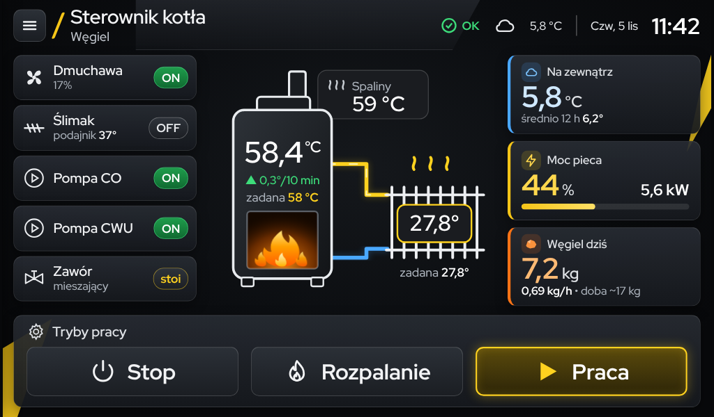
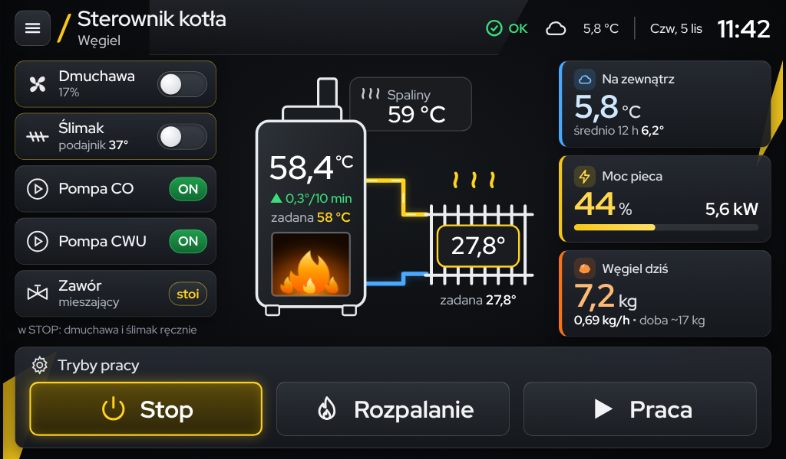

# Koncept nowego ekranu głównego

Szkic wyglądu, jeszcze niepodłączony do sterownika (dane na sztywno). Otwórz `panel.html` w przeglądarce -
kliknięcie Stop / Rozpalanie / Praca przełącza widok, ☰ wysuwa menu.

- rysunek: kocioł (temperatura, trend, zadana), komin ze spalinami, grzejnik (temperatura, zadana)
- lewa kolumna: dmuchawa, ślimak (z temperaturą podajnika), pompa CO, pompa CWU, zawór - stan ON/OFF;
  w STOP dmuchawa i ślimak dostają przełącznik ręczny zamiast stanu
- prawa kolumna: na zewnątrz, moc pieca (z paskiem), węgiel dziś
- na dole duże przyciski trybów: Stop, Rozpalanie, Praca
- menu tylko pod ☰ (wysuwane z lewej)
- rysowany na siatce 1440x850 i skalowany do ekranu; czcionka Red Hat Display (na Pi - dołączyć plik czcionki)

| PRACA | STOP |
|---|---|
|  |  |
